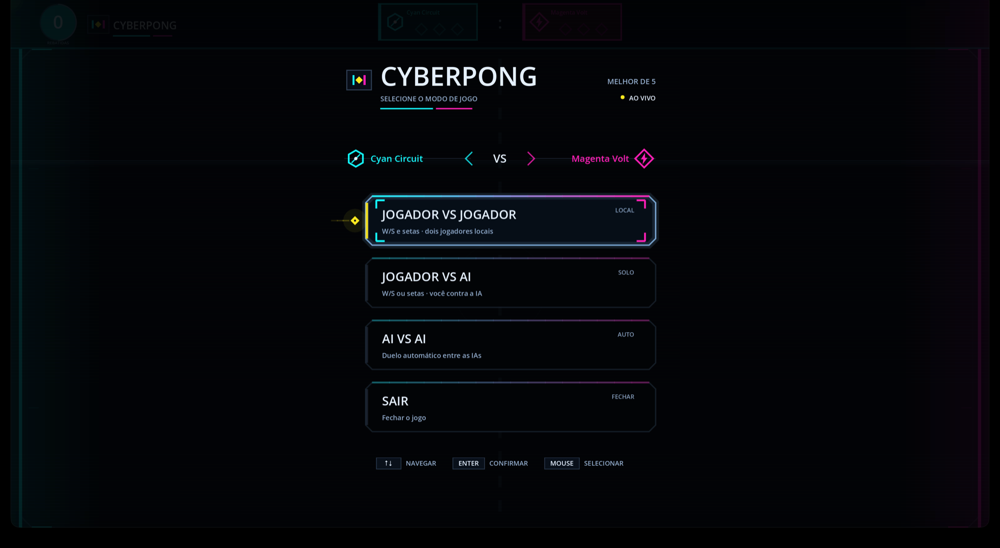
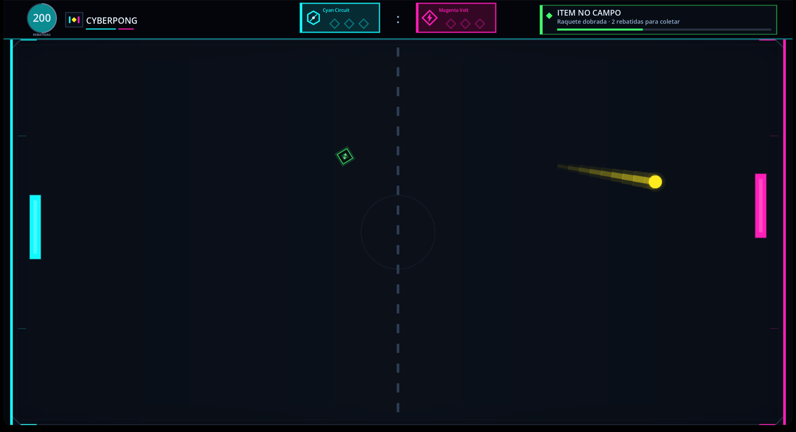
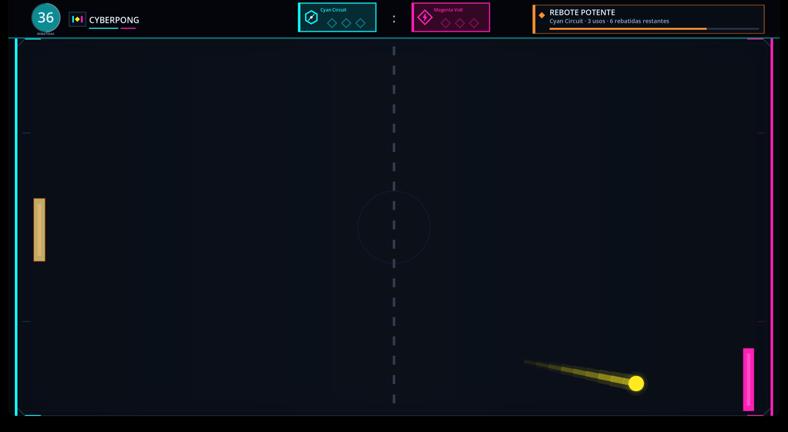
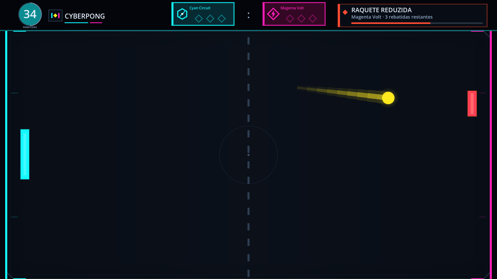

<p align="center">
  
</p>

<h1 align="center">CyberPong</h1>

<p align="center">
  <a href="https://godotengine.org/"></a>
  <a href="https://godotengine.org/"></a>
  
</p>

<p align="center">
  <b>Um duelo de Pong neon entre Cyan Circuit e Magenta Volt.</b><br>
  Melhor de cinco, power-ups e partidas contra amigos ou IAs.
</p>

## Sobre o jogo

CyberPong é um Pong 2D feito em **Godot 4 e GDScript**. As equipes **Cyan Circuit** (esquerda, ciano) e **Magenta Volt** (direita, magenta) disputam a primeira a três pontos. A arena, o placar, os menus e os efeitos são desenhados em tempo de execução com recursos nativos do Godot.

- **Dois modos:** Jogador VS Jogador e Jogador VS AI.
- **Três dificuldades:** Fácil, Médio e Difícil ajustam velocidade, reação e tolerância das IAs.
- **Power-ups:** raquetes que mudam de tamanho, bola mais lenta ou mais rápida e uma defesa extra.
- **IAs estratégicas:** as raquetes automáticas calculam a trajetória e escolhem caminhos para buscar efeitos benéficos e evitar os negativos.
- **Visual neon:** trilha da bola, faíscas com física, anel de impacto, aviso de saque e tela de vitória.

## Capturas de tela

| Partida | Rebote potente | Raquete reduzida |
|:---:|:---:|:---:|
|  |  |  |
| Item no campo e HUD superior | Rebote potente em ação | Raquete reduzida em ação |

## Como jogar

| Ação | Controle |
| --- | --- |
| Pular os créditos | Qualquer tecla ou clique |
| Navegar no menu | `↑` / `↓` e `Enter`, ou clique |
| Selecionar dificuldade | `←` / `→` com o cartão Jogador VS AI focado, ou clique nas opções |
| Movimentar no PvP (esquerda) | `W` / `S` |
| Movimentar no PvP (direita) | `↑` / `↓` |
| Movimentar no Jogador VS AI | `W` / `S` ou `↑` / `↓` |
| Pausar / retomar | `ESC` ou `P` |
| Iniciar outra partida | `Enter` após o fim |
| Voltar ao menu principal após a vitória | `M` |
| Mostrar/ocultar HUD de debug | `F3` |

- No modo **Jogador VS AI**, o lado esquerdo é humano e o direito é controlado pela IA.
- No modo **Jogador VS Jogador**, os dois lados são controlados no mesmo teclado: a esquerda usa `W`/`S` e a direita usa `↑`/`↓`.
- As ações de movimento ficam no InputMap (`p1_up`, `p1_down`, `p2_up`, `p2_down`), permitindo remapeamento sem alterar os scripts.
- O seletor de dificuldade aparece no menu somente quando o cartão **Jogador VS AI** está focado; no PvP ele fica oculto e a dificuldade não altera a partida.
- O cartão **Configurações** do menu inicial abre o mesmo painel de ajustes do menu de pausa (volume, som e tela cheia) sem iniciar a partida.
- No menu de pausa, **Continuar** retoma o rally no mesmo estado, **Reiniciar partida** zera o placar e começa um novo rally, **Configurações** abre volume, som e tela cheia, e **Menu principal** encerra a partida e restaura placar, rebatidas, power-ups, velocidade e tamanho das raquetes.
- Na tela de vitória, **Enter** inicia outra partida e **M** volta ao menu principal restaurando os valores padrão. As linhas **NOVA PARTIDA** e **MENU PRINCIPAL** também são clicáveis com o mouse.
- A tela de créditos da **Moron Souls Productions** aparece somente na abertura do jogo.

### Dificuldades

A dificuldade escolhida no menu vale para toda raquete controlada pela IA. No modo **Jogador VS Jogador** ela não altera a partida. O padrão é **Médio**, e a escolha permanece ao voltar ao menu principal.

| Dificuldade | Velocidade da IA | Atraso de reação | Zona morta |
| --- | --- | --- | --- |
| **Fácil** | 64% da velocidade da raquete | 0,30 s | 38 px |
| **Médio** | 82% da velocidade da raquete | 0,14 s | 24 px |
| **Difícil** | 100% da velocidade da raquete | 0,04 s | 12 px |

A dificuldade altera apenas o comportamento das IAs; regras, velocidade da bola e power-ups continuam iguais.

### Regras da partida

- Vence quem marcar **três pontos**.
- O primeiro saque sai a **1.140 px/s**; os saques seguintes saem a **1.500 px/s**.
- A aceleração normal aumenta **10% a cada dois rebatimentos**, até **3.000 px/s**.
- Quando uma equipe chega a **dois pontos**, ela entra em **match point**: o placar recebe um selo pulsante "MATCH POINT" na cor da equipe.
- O HUD superior mostra o total de rebatidas, o placar e o estado do power-up.
- O HUD de debug começa oculto e exibe velocidade e rebatidas por IA no canto inferior esquerdo.

## Power-ups

O primeiro item aparece após **5 a 15 rebatidas totais**; os próximos seguem o mesmo intervalo. Se um efeito ainda estiver ativo, o item seguinte espera ele terminar. A bola precisa tocar o item para coletá-lo, e ele pertence à última raquete que rebateu. Sem coleta, o item desaparece após **cinco rebatidas**. Quando alguém marca um ponto, um item disponível no campo some como se a área tivesse sido resetada.

| Efeito | Duração | O que faz |
| --- | --- | --- |
| **Raquete dobrada** | 6 rebatidas | Dobra a altura da raquete beneficiada. |
| **Raquete reduzida** | 5 rebatidas | Reduz pela metade a altura da própria raquete de quem coletou. |
| **Freio na bola** | 8 rebatidas | A dona rebate na velocidade atual; a adversária devolve 8% mais devagar. |
| **Rebote potente** | 8 rebatidas | A dona acelera a bola em 18% por rebatida, até 3.540 px/s. A raquete adversária devolve a 3.000 px/s. |
| **Defesa extra** | 14 rebatidas | Salva uma falha e termina ao ser usada. |

As durações contam rebatidas das duas raquetes. Freio na bola e Rebote potente valem pelos próximos quatro rebatimentos da raquete afetada. Quando há um item disponível, a IA tenta direcionar a bola aos efeitos benéficos e evitar a raquete reduzida, considerando as quicadas nas bordas.

## Executar

Você precisa do **Godot 4.7.x**. Abra `project.godot` no editor e use **Executar projeto**, ou rode no terminal:

```bash
godot --path .
```

O jogo abre `main.tscn` em tela cheia, com o renderer `gl_compatibility`. Não há dependências externas em tempo de execução.

## Testes

A suíte usa **GUT 9.7.1** (MIT), presente em `addons/gut/` apenas para desenvolvimento. Os testes ficam em `test/unit/` e `test/integration/`.

```bash
godot --headless --path . -s addons/gut/gut_cmdln.gd -gdir=res://test -ginclude_subdirs -gexit
```

Se o executável não estiver no `PATH`, use o caminho completo do Godot. Para exportar o resultado em JUnit XML, crie `reports/` e acrescente `-gjunit_xml_file=reports/gut-results.xml`. O arquivo registra resultados dos testes, não cobertura de código.

Em um clone novo, ou sempre que a pasta `.godot/` não existir, importe os recursos antes de rodar a suíte. Sem esse passo o Godot não encontra os `class_name` do GUT nem os arquivos de áudio importados e a execução falha:

```bash
godot --headless --path . --import
```

## Integração contínua

O workflow `.github/workflows/tests.yml` roda a cada push em `main` e em cada pull request. Ele instala o Godot 4.7 no runner, importa os recursos do projeto, executa a suíte GUT em modo headless e publica o relatório JUnit:

- `godot --headless --path . --import` roda antes da suíte para gerar os arquivos importados e o cache de `class_name` do GUT, ausentes em um checkout limpo.
- `reports/gut-results.xml` é gerado com `-gjunit_xml_file` e enviado como artefato `gut-junit-report`.
- O resumo com o total de testes e falhas é escrito no relatório do job.
- A execução falha quando há testes quebrados, porque o GUT encerra com código diferente de zero.

<details>
<summary><b>Plano de testes detalhado</b></summary>

**Unitários**

- `test_ball.gd`: saques, sinal de velocidade, aceleração e limites, Rebote potente, Freio, colisões, falhas, Defesa extra, coleta varrida e última raquete.
- `test_difficulty.gd`: ordem dos presets, padrão, títulos e conversão entre nível e índice.
- `test_paddle.gd`: posição, colisão, previsão com reflexão, movimento, zona morta, dificuldade aplicada, tamanho dos efeitos, camadas visuais e mira.
- `test_power_up.gd`: catálogo centralizado, aparição, janela de cinco rebatidas, coleta, proprietário, durações, cargas, sinais, HUD, cores e redimensionamento.
- `test_debug_hud.gd` e `test_spark_effects.gd`: visibilidade e contagens do HUD; quantidade, expiração, quique e anel de impacto.
- `test_credits_screen.gd`: layout, fade, emissão única de `finished`, pulo por tecla/clique e janelas diferentes.
- `test_sound_manager.gd`: catálogo de efeitos sonoros, pool de AudioStreamPlayers, reprodução desativável, variação de tom por velocidade e efeitos de power-up.
- `test_game_menu.gd`: layout responsivo, cartões, foco, cursor, seletor de dificuldade condicional, abertura das configurações, seleção, transição e início/saída.
- `test_pause_menu.gd`: cartões, layout, foco, transição, retomada por ESC, reinício da partida e abertura das configurações.
- `test_settings_menu.gd`: cartões de volume, som e tela cheia, limites de volume, retorno e fechamento por ESC.

**Integração**

- `test_credits_flow.gd`: abertura pelos créditos, entrega ao menu, bloqueio de teclas e ausência de repetição ao voltar da pausa.
- `test_menu_flow.gd`: pausa da partida, seleção de modo e dificuldade, aplicação na IA, retomada, abertura das configurações pelo menu inicial, modos PvP/Jogador VS AI e encerramento.
- `test_pause_flow.gd`: abertura por ESC/P, congelamento, retomada sem alterar o estado, reinício da partida, abertura das configurações e restauração dos padrões.
- `test_sound_flow.gd`: integração de áudio com rebatidas, paredes, power-ups, saques, pontos, vitória e transições de pausa.
- `test_main_flow.gd`: nós e sinais, saques, placar, match point, vitória, retorno ao menu pelo `M`, clique nos botões da tela de vitória, aviso, transição de ponto, power-ups, teclas, HUD e redimensionamento.
- `test_scene_resources.gd`: carregamento das cenas e disponibilidade da fonte de fallback.
- `test_visual_verification.gd`: limites em várias resoluções, sobreposição do HUD, contraste e efeitos visuais.

Os testes validam intervalos e invariantes quando há aleatoriedade e rodam em modo headless. Para o que depende de apresentação, complemente com verificação manual no Godot e mantenha um teste de regressão para cada bug reproduzível.

</details>

## Estrutura

<details>
<summary><b>Ver estrutura de arquivos</b></summary>

```text
.
├── main.tscn / main.gd     # Cena principal, créditos, menus e regras da partida
├── project.godot           # Configuração, janela, autoload e cena de entrada
├── guia-visual.md          # Paleta, identidade das equipes e critérios visuais
├── assets/icons/           # Avatar da tela de créditos
├── assets/audio/           # Efeitos sonoros sintetizados (WAV)
├── scenes/                 # Cenas de bola, raquetes, créditos, menu, pausa e configurações
├── scripts/                # Arena, bola, raquetes, áudio, dificuldade, menus, HUD, power-ups e efeitos
├── test/unit/              # Testes unitários
├── test/integration/       # Testes de cenas, sinais e fluxos
├── .github/workflows/      # CI com GUT headless e relatório JUnit XML
├── docs/screenshots/       # Capturas usadas neste README
└── addons/gut/             # GUT 9.7.1, somente desenvolvimento e testes
```

</details>

## Créditos e licenças

O único arquivo de imagem do jogo é o avatar da tela de créditos. Todo o restante é desenhado pelo código com `_draw()`, `Polygon2D`, `Line2D`, `ColorRect` e controles nativos do Godot.

| Recurso | Origem | Licença |
| --- | --- | --- |
| Avatar da Moron Souls Productions (`assets/icons/moronsouls_avatar.png`) | Avatar do canal [@moronsouls4405](https://www.youtube.com/@moronsouls4405), recortado sem fundo | Arte fornecida pelo autor; confirme a licença antes de redistribuir |
| Efeitos sonoros (`assets/audio/*.wav`) | Síntese procedural via `scripts/generate_audio.py` | Código e áudio próprios |
| Arena, HUD, placar, emblemas, power-ups, menus e efeitos | Código do projeto | Código próprio |
| Tipografia | `ThemeDB.fallback_font` do Godot | Conforme a distribuição do Godot |
| GUT 9.7.1 | `addons/gut/` | MIT |

O avatar pode ser substituído mantendo o caminho referenciado por `scenes/credits_screen.tscn`. Se outro recurso externo for adicionado, registre aqui a origem e a licença.

## Detalhes técnicos

<details>
<summary><b>Ver responsabilidades dos scripts e regras de implementação</b></summary>

- `main.gd` coordena créditos, menus, modos, placar e o estado da partida; conecta os sinais da bola e reinicia os valores padrão ao voltar ao menu principal.
- `ball.gd` implementa movimento e colisões por código, sem nós de física, e emite `speed_changed` no saque e a cada mudança de velocidade.
- `paddle.gd` controla movimento humano e IA, aplica os parâmetros da dificuldade, calcula a previsão com reflexões nas bordas e atualiza colisão e visual quando recebe um efeito.
- `difficulty.gd` define os presets Fácil, Médio e Difícil, com velocidade, atraso de reação e zona morta das IAs.
- `power_up_effect.gd` centraliza os IDs (`PowerUpEffect.Id`) e o catálogo (`PowerUpEffect.CATALOG`) dos efeitos; `power_up.gd` agenda aparições a cada 5–15 rebatidas totais e controla coleta, proprietário e duração.
- `palette.gd` centraliza a paleta compartilhada e a identidade das equipes (`Palette.team_color`, `Palette.team_name`); `game_mode.gd` define a enumeração única dos modos de jogo; `ui_draw.gd` concentra os helpers de desenho (ajuste de fonte, geometria dos cartões, pips e emblemas das equipes).
- `arena.gd` desenha a arena em camadas, o placar, o aviso de saque, a transição de ponto, a tela de vitória e o HUD superior.
- `sound_manager.gd` (autoload `SoundManager`) gerencia e reproduz os efeitos sonoros via pool de áudio com modulação de tom por velocidade, sons por equipe e por tipo de power-up.
- `menu_screen.gd` concentra layout, desenho e foco compartilhados, incluindo o seletor de dificuldade; `game_menu.gd`, `pause_menu.gd`, `settings_menu.gd` e `credits_screen.gd` usam esse template.
- `debug_hud.gd` exibe velocidade e rebatidas por IA com `F3`; `spark_effects.gd` simula as faíscas e o anel de impacto.
- A resolução de viewport em `project.godot` é **2880 × 1620**, em tela cheia. A escala é definida por `GAME_SCALE` em `main.gd` e o HUD respeita `HUD_BAR_HEIGHT`.

</details>
